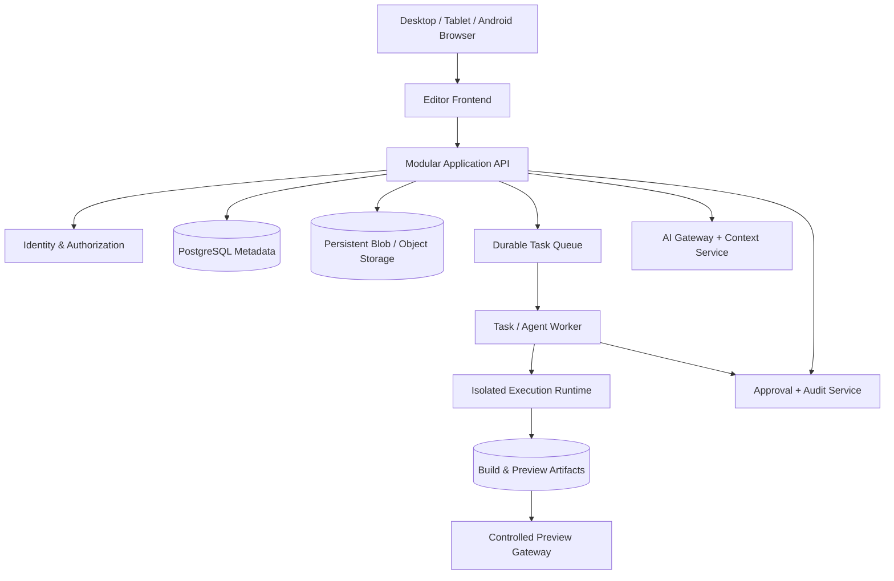

# REVORA IDE — Architecture Map (Proposed)

## Current-state finding

No application architecture is present in the inspected remote repository. The following diagram is a recommended target architecture only; it is not a description of existing services.

## Target logical architecture

## Frontend boundaries

- Application Shell and responsive layout manager.
- Project/workspace context manager.
- File explorer and file operation state.
- Multi-model source editor with tab/dirty-state lifecycle.
- Revision timeline and diff review.
- AI assistant and context visibility.
- Patch proposal/review/application controls.
- Bottom workbench for terminal, build/test, preview, and logs.
- Agent task and approval activity.

## Backend boundaries (one modular application initially)

- Project and Workspace modules.
- File and Revision modules.
- Patch Integration module.
- AI Gateway and Context module.
- Task/Agent orchestration module.
- Build/Test and Artifact modules.
- Runtime adapter (control plane only; execution occurs outside API process).
- Approval and Audit modules.

## Infrastructure boundaries

- Relational database for metadata, authorization, revision indexes, task state, and audit metadata.
- Durable object/blob storage for file snapshots, large files, logs, and artifacts.
- Durable queue for task dispatch and retries.
- Isolated ephemeral execution runtime with resource quotas and deny-by-default network policy.
- Observability: structured logs, metrics, traces, job correlation IDs, and alerting.
- Secret manager; credentials never enter browser bundles, prompts, logs, or sandbox environments by default.

## Key architectural decisions for Stage 2

1. Prefer a modular monolith plus isolated worker/runtime over premature microservices.
2. Use immutable revision records and optimistic concurrency (`base_revision` / ETag) for every write path.
3. Store file metadata transactionally and file content in durable blob storage; define atomicity/compensation behavior.
4. Make AI output a patch proposal, never a direct privileged filesystem write.
5. Pin every task, build, test, and preview to an immutable revision or artifact digest.
6. Use a separate preview gateway with scoped, expiring access.
7. Treat mobile as a first-class interaction model, not merely a CSS breakpoint.

## Reuse strategy

No existing service can be confirmed reusable in this repository. If shared services exist in sibling repositories, Stage 2 must inspect their APIs, ownership, security model, deployment maturity, and maintenance cost before integration. Do not assume that an installed package or a neighboring project is production-ready.
